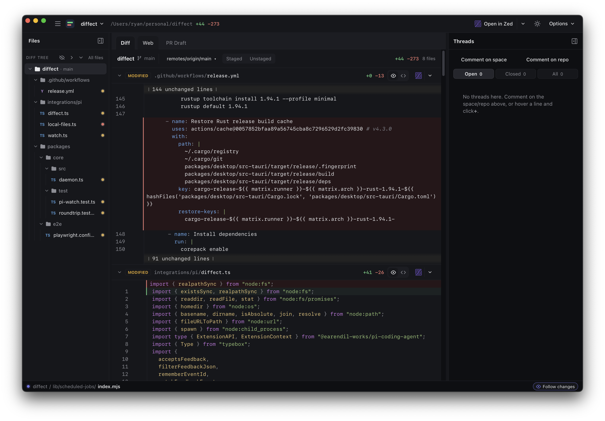
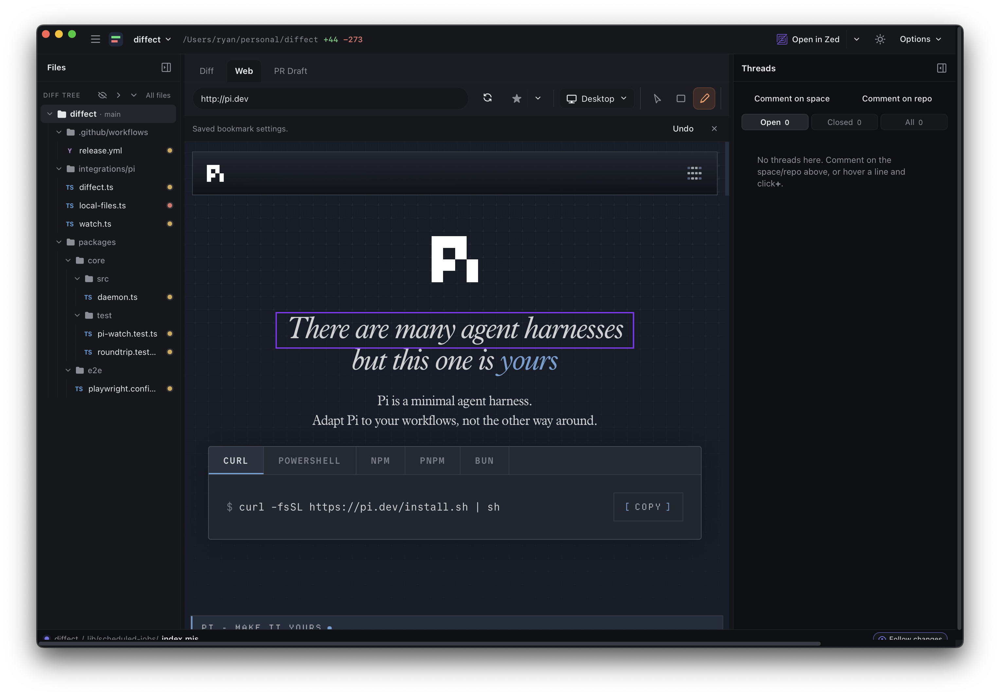

#  Diffect

[](https://github.com/ryanmazzolini/diffect/actions/workflows/ci.yml)
[](https://github.com/ryanmazzolini/diffect/releases/latest)

Diffect is a local-first code review surface for humans and coding agents to collaborate.

<p align="center">
  
</p>

Diffect runs as a desktop (Tauri) app or web-ui daemon. It doesn't ship with any embedded AI conversation panes. Instead, use your favourite harness and follow along live in diffect.

There is a native pi extension for proactive commenting + resolution, which provides a real-time surface between agents.

### Why

Most AI review tools start with a pull request. I wanted to review work earlier, locally and with faster feedback loops.

Diffect is similar to other local code-review tools, but this isn't a TUI, and the workflow is work-space oriented instead of single-repo-oriented.

## Download

[Download the latest release](https://github.com/ryanmazzolini/diffect/releases/latest)
for:

- **macOS:** zipped apps for Apple Silicon and Intel
- **Linux:** x86_64 AppImage

Every release includes SHA-256 checksums and GitHub build-provenance
attestations. The macOS apps are currently ad-hoc signed, so macOS may ask you to
confirm the first launch. Signed installers, notarization, and auto-updates are
not built yet.

To install the latest stable release as `diffect-desktop` with
[mise](https://mise.jdx.dev):

```sh
# Linux x86_64
mise use -g 'github:ryanmazzolini/diffect[matching=linux,bin=diffect-desktop]@latest'

# macOS Apple Silicon; use matching=macos-x86_64 on an Intel Mac
mise use -g 'github:ryanmazzolini/diffect[matching=macos-aarch64,strip_components=0,bin_path=Diffect.app/Contents/MacOS,filter_bins=diffect-desktop]@latest'
```

Mise's GitHub backend ignores prereleases for `latest`. Run `mise upgrade` to
install a newer stable release. If you download an AppImage directly, make it
executable before launching it.

## Status

Diffect is **experimental** but usable from a source checkout or downloadable
desktop build. Hosted review, GitHub sync, and remote authentication are not
built in (yet?).

## Features

### Workspace review
Diffect provides typical review UI functions. Additionally you can:

- Review all the repositories and Git worktrees in a root workspace
- **Follow changes** while an agent works across your local files
- Browse any workspace file and make quick edits
- Keep a separate pull request draft for each repository.

### Working with agents

Any agent can integrate with `diffect` via the CLI to leave comments, list comments, create a PR draft etc.

The bundled [pi extension](integrations/pi/README.md) is more tightly integrated. Connect a pi session with `/diffect-connect` and new comments will trigger the agent automatically.

### UI Inspection

The desktop app provides a simple website review tool, with element picker and selection screen-shot tools. Switch among desktop, tablet, and mobile viewports, and keep frequently reviewed pages in bookmarks and history.

<p align="center">
  
</p>

## CLI

The CLI is not packaged separately yet. After you [set up a source checkout](#set-up-a-source-checkout),
build it and add an alias:

```sh
pnpm build
alias diffect="node /path/to/diffect/packages/core/dist/cli.js"
```

You can then use it from any repository:

```sh
cd /path/to/repo
diffect list --status open
diffect comment --file src/a.ts --line 42 --severity must-fix --body "…"
diffect reply <id> --agent claude --body "fixed"
diffect resolve <id> --summary "fixed in this change"
```

By default, Diffect reviews all work on the current branch, including staged,
unstaged, and untracked files. Use `--target` to review only staged or unstaged
changes, another branch or commit, or a comparison such as `main..feature`. Use
`--repo` or `--worktree` to choose a specific checkout in a larger workspace.

## Development

### Set up a source checkout

This repository uses [mise](https://mise.jdx.dev) to install the right versions
of Node, pnpm, and Rust. For safer installs, it blocks dependency install
scripts and waits three days before installing a newly published package.

```sh
mise install
pnpm install
```

### Run the app

To run Diffect in your browser:

```sh
mise run daemon -- --workspace /path/to/repo
# open http://127.0.0.1:7421
```

Leave out `--workspace` to review the repository in your current directory.

To run the desktop app:

```sh
mise run desktop
```

For browser UI changes with hot reload, use two terminals:

```sh
mise run daemon   # terminal 1
mise run dev      # terminal 2
```

### Checks

Before opening a pull request, run the full set of checks:

```sh
mise run build
mise run test
mise run desktop:check
```

See [CONTRIBUTING.md](CONTRIBUTING.md) for the rest of the contributor notes.

### Releases

Release Please keeps a release pull request up to date from the commit messages
on `main`. Merging it creates a draft GitHub release. GitHub Actions then builds
the desktop app for every supported platform and publishes the release only if
all the builds succeed.

If a build fails, rerun the Release workflow with the draft release tag, such as
`vX.Y.Z`.

## Review data

Diffect keeps review data in `$XDG_CONFIG_HOME/diffect/`, or
`~/.config/diffect/` by default. It is stored outside your repositories and is
not committed with your code.

The desktop app, browser UI, CLI, and agent integrations all use these same
files:

- Repository comments: `workspaces/<hash>/threads.jsonl`
- Workspace comments: `spaces/<hash>/threads.jsonl`
- Attachments: `attachments/`
- Known workspaces: `workspaces.json`

The hashes come from the full path to each workspace and stay local to your
machine. If Diffect finds review data from an older version in
`.reviews/threads.jsonl`, it copies the data into the current store and leaves
the original file in place as a backup.

## Networking and security

By default, `diffectd` only accepts connections from the same machine
(`127.0.0.1`). It does not have authentication yet. If you change `--host`, only
expose it inside a network you trust.

Report security problems privately; see [SECURITY.md](SECURITY.md).

## Related projects

- [hunk](https://github.com/modem-dev/hunk) — terminal review UI for
  agent-authored changesets.
- [herdr](https://github.com/ogulcancelik/herdr) — terminal workspace manager
  for AI coding agents.
- [cmux](https://github.com/manaflow-ai/cmux) — macOS terminal/workspace for AI
  coding agents.
- [diffity](https://diffity.com) by [Kamran Ahmed](https://kamranahmed.se) — a
  GitHub-style git diff viewer in the browser, and the visual inspiration for
  Diffect's diff view.

## License

Apache-2.0. See [LICENSE](LICENSE). Vendored editor icons are attributed in
[third-party assets](docs/third-party-assets.md).
